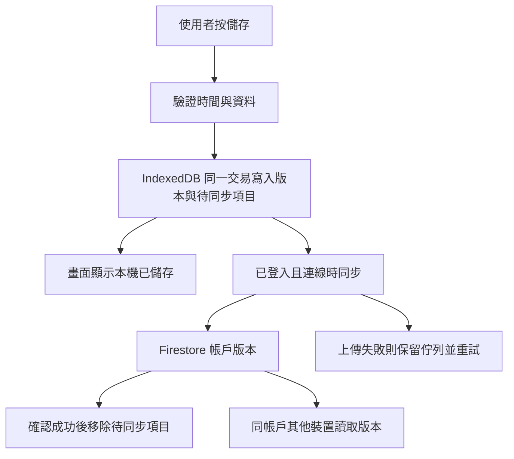

# ONTIME 設計思路、使用需求與實作說明

更新：2026-10-14（America/Toronto）。本文整理已確認的需求，以及截至 [工作日升級 #11](https://github.com/hasonk200/codex/pull/11) 的實作。範例時間是示意，不是私人帳戶的紀錄。

## 1. 這個 App 要幫我做什麼？

我想知道自己這一個工作日發生了什麼：幾點出門、搭車、上班、下班、回家、吃飯和睡覺。記錄應該像日常習慣，按一下或補一個時間就可以，之後由 App 把事情接起來。

我的作息可能是夜班。對朝九晚五的人，週一上班、晚上睡覺，很容易理解「週一的一天」。我可能週一晚上上班，週二早上下班，週二白天才睡覺。App 需要讓我同時看懂：**這是我的週一工作日，但這個事件實際發生在週二。**

這是目前設計的核心。其他功能都要配合真實作息，減少重複輸入，並讓已知、預計和未知的事情容易分辨。

## 2. 已確認的需求，以及為什麼這樣設計

| 我的需求 | 現在的設計 | 原因 |
| --- | --- | --- |
| 夜班過了午夜，我仍然知道自己在哪一個工作日 | 以上班日期命名工作日；事件另外顯示實際日期、星期和時間 | 生活的接續和日曆的日期都需要看得懂 |
| 不想每次自己整理跨日紀錄 | 首頁、睡眠和「我的時間」依班次接續；睡眠可修正所屬工作日 | 自動配對處理一般情況，也保留更正的入口 |
| 想知道睡前還有多少時間 | 工作日主要顯示到預計入睡前的未安排時間 | 夜班的休息界線可能在中午，午夜不是每天的作息終點 |
| 睡眠要有獨立頁面，自己記下的時間最重要 | 「睡眠」是獨立導覽頁；實際紀錄、計時與趨勢優先，計畫另放 | 計畫不代表已經睡過，也不應延長實際計時 |
| 補登一個時間，不想面對整張大表格 | 先選環節，再填該環節的日期和時間；其他選項另外展開 | 一次完成一件事，避免誤改別的時間 |
| 出門後還有搭車，回家前也有搭車 | 去程、回程搭車分開記錄，也允許步行直接抵達 | 通勤包含不同環節，不是每一趟都有搭車 |
| 上班也可以吃飯 | 手動用餐可以和工作、通勤重疊；不會因此補休息或扣薪 | 吃飯和出勤是不同紀錄 |
| 用餐除了時間，也想加圖片 | 每餐可加入一張可預覽、更換、移除的相片 | 相片跟同一餐保存，不用另外管理圖片網址 |
| 外送按單收入，不能只用時薪算 | 可記整次實收總額與完成訂單數；另保留時薪、不計薪方式 | 工時不等於按單工作的收入 |
| 沒有網絡仍要記錄，有網絡再上傳 | 先寫入本機，再透過待同步佇列上傳 | 按儲存時不應等網絡回應 |
| 手機上要像 App 一樣方便使用 | 可安裝的 PWA、底部導覽、手機表單與固定儲存按鈕 | 日常打卡需要容易按、容易重開 |
| 字體和次要選單要清楚、現代 | 共用字體、文字層次、卡片與表單規則；選填項目按需要展開 | 畫面應先讓人知道現在要做什麼 |

## 3. 「我的一天」怎樣計算？

### 工作日與日曆日是兩個查看方式

例如這一段作息：

| 實際日期 | 事件 | 歸在哪個工作日 |
| --- | --- | --- |
| 週一 21:00 | 上班 | 週一 |
| 週二 09:00 | 下班 | 週一 |
| 週二 10:00 | 到家 | 週一 |
| 週二 12:00–20:00 | 下班後睡眠 | 週一 |
| 週二 21:00 | 下一次上班 | 週二 |

「工作日」把相關班次、通勤與恢復睡眠放在一起；「日曆日」查看當地 00:00 至下一個 00:00 的時間分配。工作日不是固定長度的 24 小時區間，也不會把真實時間戳記搬到前一天。

跨日工時仍按實際日曆日期分配；收入按開始上班日期歸屬，避免同一筆整次收入算兩次。

### 開啟頁面時，先看哪一天？

目前優先顯示進行中出勤的上班日，再看進行中睡眠所屬工作日。沒有進行中紀錄時，通常接續最近 36 小時內完成的出勤；若下一個已排班的班次已開始，則切到新班次的上班日。

沒有近期出勤時，會看未來 24 小時內的下一班；仍沒有時，使用現在的日曆日期。這些時間範圍只用於選擇初始畫面，日期仍可自行切換。它們不是「每個人一定要這樣生活」的規則。

### 睡眠怎樣接回工作日？

- 每筆睡眠可保存 `workdayDate`，表單中叫「所屬工作日（依上班日期）」。修改歸屬不會修改入睡或起床時間。
- 舊紀錄沒有這個欄位時，會依睡眠開始前的班次推算，實際出勤優先於排班。已結束的班次須在睡眠開始前 24 小時內；未結束出勤只能以開始時間作有限配對。
- 找不到合適班次時，暫按入睡日期整理。明確清除歸屬則保存 `null`，按入睡日期查看。
- 新的工作日表單會帶入所選工作日；已知下班日期時，入睡日期帶入該日期。按「現在入睡／現在起床」也會保存或保留歸屬。
- 日曆日模式下，已完成睡眠按起床日期查看，進行中睡眠與未完成計畫按入睡日期查看。完整睡眠時數保留，不在午夜切斷睡眠紀錄卡。

### 實際、預計、未知要分清楚

同一筆睡眠只要已開始記錄實際時間，時間安排就優先使用實際區間。尚未記起床時只計至現在；原本預計起床時間不會當作已睡過的時間。

新計畫不預填 23:00–07:00。有完整實際紀錄時，可以主動選「沿用最近一次睡眠時段」帶入新計畫；這不會建立實際睡眠。近七天平均只計有完整實際紀錄的日期，重疊的睡眠合計只算一次，缺少紀錄顯示「—」。

沒有抵達、離開或睡眠時間，就保留未知。通勤配對優先用既有連結，再看同一工作和這趟通勤的時間範圍；不能為了填滿畫面而借用另一班的上下班紀錄。

### 剩餘時間不是休息時數

「距離預計入睡」是單純的倒數，仍包含期間的工作和通勤。

「到預計入睡前的未安排時間」則從現在算到預計入睡，扣除已知或預估占用的工作、通勤、已確認用餐和有效睡眠安排。重疊區間合併後再扣除，例如工作中吃飯只占用一次時間。

沒有睡眠目標就顯示未設定，不以午夜替代。日曆日的午夜預算另行顯示。未記錄的睡眠不能當作已休息，缺少時間也可能讓未安排時間偏高。

## 4. 七個頁面各自負責什麼？

| 頁面 | 主要工作 |
| --- | --- |
| 今天 | 現在狀態、快捷記錄、這趟通勤進度、工作日作息接續、下一餐與收入入口 |
| 班表 | 工作設定、預定班次、月曆／週時間軸／清單、範本與批次建立 |
| 用餐 | 安排或補登餐次、選填餐點／地點／備註／相片，以及確認建議 |
| 睡眠 | 實際紀錄與入睡／起床計時、工作日歸屬、近七天趨勢、睡前安排 |
| 我的時間 | 工作日的跨日時間線、睡前未安排時間；另可切換日曆日統計 |
| 統計 | 出勤、通勤、計薪、實收、訂單數與 CSV 匯出 |
| 我的 | 個人與外觀設定、登入／同步、版本衝突、JSON 備份匯入／匯出 |

介面採取「先做主要動作，再看選填內容」：例如補登先選哪一個時間，用餐先填開始和結束。夏令時間的重複時間選項只在真正需要選擇時出現。

英文與數字使用 Inter，繁體中文使用 Noto Sans TC；字體檔案放在 App 內，按字集載入。時間使用等寬數字，主要文字以 400–600 字重建立層次，深淺色共用設計規則。

## 5. App 是怎樣建成的？

### 程式和部署

目前是靜態網頁 App：React 與主要邏輯已打包在 [`index.html`](index.html) 的內嵌 JavaScript。時間處理使用 Temporal，資料格式以 Zod 驗證。現有版本可直接部署，沒有額外的前端建置步驟。

GitHub Pages 提供 `/codex/ontime/` 的畫面和靜態資源；儲存庫根目錄的 `index.html` 負責轉向。Firebase Authentication 處理 Google 登入，Firestore 保存帳戶的雲端版本。這個設計不會把使用者打卡資料送到 GitHub。

| 檔案 | 作用 |
| --- | --- |
| [`index.html`](index.html) | React 畫面、記錄表單、時間計算、資料驗證、本機儲存與同步邏輯 |
| [`assets/app.css`](assets/app.css) | 原有版面結構 |
| [`assets/design.css`](assets/design.css) | 共用字體層次、卡片、表單、睡眠與工作日介面、手機和深淺色樣式 |
| [`assets/fonts/`](assets/fonts/) | 本機提供的字體、字集與授權 |
| [`assets/pwa.js`](assets/pwa.js) | 瀏覽器安裝提示與已安裝狀態 |
| [`manifest.webmanifest`](manifest.webmanifest) | App 名稱、圖示、啟動網址與安裝範圍 |
| [`sw.js`](sw.js) | Service Worker：公開 App 外殼和靜態資源快取、離線開啟與更新 |
| [`../firestore.rules`](../firestore.rules) | 限定登入者存取自己 UID 下的版本；雲端版本只可讀取與新增 |
| [`../tests/`](../tests/) | Playwright 與 Node 測試、隔離資料及模擬同步服務 |

維護跨日功能時，可在 HTML 搜尋 `ontimeWorkdayForNow`（目前工作日）、`ontimeSleepWorkday`（睡眠歸屬）、`ontimeBeforeBedBudget`（睡前時間預算）、`ontimeRouteSession`（通勤與出勤配對）和 `ontimeRecordingField`（共用時間欄位），並對照 [`recording.test.cjs`](../tests/recording.test.cjs) 的情境。

### 資料分開保存，再組合成畫面

| 資料 | 用途 |
| --- | --- |
| `jobs`、`shifts`、`templates` | 工作設定、預定班次、可重用範本 |
| `sessions` | 實際上下班、休息、計薪快照、整次實收和訂單數 |
| `journeys` | 出門、兩段搭車、抵達、離開、到家，以及出勤／班次連結 |
| `meals` | 用餐時間、內容、相片與是否已確認 |
| `sleeps` | 預計與實際入睡／起床、工作日歸屬、備註 |
| `dayMarks`、`settings` | 休假／不可用等日期標記，以及個人偏好 |

例如，記錄一餐不會修改 `sessions` 的上下班或休息。改工作計薪設定也不會直接改掉所有舊出勤；歷史紀錄保存當時的計薪快照，需要修正時再明確修改。

相片先在裝置上壓縮為最長邊 1280 像素內的 JPEG，圖片資料上限 256 KiB，跟同一餐的版本一起保存和同步。JSON 備份包含相片，CSV 不包含；複製餐次到別天也不會把相片當成另一日的用餐實錄。

### 離線與同步流程

修改會新增 revision（版本），並記下它接續哪些舊版本，而非直接覆寫雲端原紀錄。刪除也以刪除版本表示。多裝置同時改同一筆可能產生版本衝突，要讓使用者處理，不能默默丟掉其中一份。

Service Worker 快取的是公開畫面、字體和圖示；個人資料存在帳戶對應的 IndexedDB 和 Firestore。登入成功不等於每筆紀錄都已上傳，應看待同步數量與同步狀態。JSON 備份另外保存版本歷史，方便還原和搬移。

PWA 讓同一個網頁能從手機主畫面開啟。首次開啟、快取資源和首次登入需要連線；完成後可離線記錄及重開。已有新版時先完成或關閉表單，再按「更新」。

## 6. 已知限制與仍未實作的想法

### 現在需要知道的限制

- 自動配對依記錄與時間範圍判斷，不能確定每一段都是主睡眠或午睡。多份工作、漏打卡、額外小睡或很長的休息間隔可能需要手動更正工作日。
- 沒有睡眠計畫就無法給出睡前剩餘時間。極遠的睡眠目標也不提供這個估算；目前計算最多檢視八個日曆日。
- 本機保存依賴瀏覽器儲存空間。清除網站資料、換裝置或不同安裝環境，不一定保留同一份本機資料；雲端同步與匯出備份仍有用途。
- 按單收入需要自行填整次總額和訂單數；目前沒有連接外送平台自動匯入。
- 目前的「自動」主要是時間規則、配對、建議和同步。沒有 AI 模型在背景讀取私人紀錄、判定已吃飯／已睡覺，或自動寫入實際時間。
- 單一 HTML 內含大量打包程式，部署簡單，但修改與審查較難；樣式也分成原有結構和後續設計層。這是目前結構的取捨，不是未來一定要沿用的形式。

### 可以再討論，尚未實作

1. 拆分可維護的原始碼模組，讓時間規則、資料層、同步與畫面更容易各自修改和測試。
2. 更明確地區分恢復睡眠、午睡與多班次，讓自動歸屬容易解釋，也容易更正。
3. 根據多次實際紀錄提供作息建議，顯示依據並由使用者確認；任何建議仍不能代替實際打卡。

這些是後續方向，不能當作現在已經具有的功能。

## 7. 之後修改時，怎樣知道有沒有改壞？

最重要的檢查情境是：週一夜班、週二下班、回家、白天睡眠，仍可在同一工作日看見；事件的真正日期、星期和實際時數都正確。朝九晚五也應沿用同一套規則。

此外要檢查：

- 實際睡眠優先於計畫；計時未結束、跨午夜、夏令時間和重疊紀錄都算對。
- 補一個環節只改那個時間，保留其他打卡、收入、休息、備註與版本。
- 工作中吃飯可以儲存，時間不重複扣除，出勤與薪資不因用餐而改變。
- 按單收入的未知、零和已填總額保持區別；跨日收入只算一次。
- 相片、睡眠歸屬及其他紀錄在離線儲存、重開、同步和 JSON 備份後仍保留。
- 小手機、桌面、深淺色、日期與時間輸入，以及可見的儲存按鈕都可使用。

測試命令與環境說明見 [根目錄 README](../README.md#介面回歸測試)。工作日升級完成時，完整 Chromium 回歸為 62 項通過，另做 WebKit、跨日／離線同步及正式網站隔離示範資料驗證。這是該次版本的驗證紀錄，未來修改仍需按影響範圍重新檢查。

預覽：[工作日手機](../docs/workday-time-mobile.png) · [睡眠手機](../docs/workday-sleep-mobile.png) · [工作日桌面](../docs/workday-time-desktop.png)。

每次改動需求或時間規則，應一起更新這份文件，寫清楚「需求是什麼、為什麼這樣做、目前做到了哪裡」，讓下一次開發接續同一個方向。
